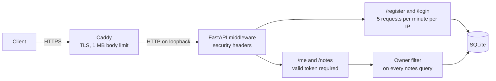
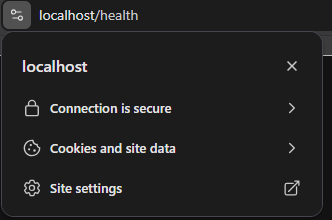
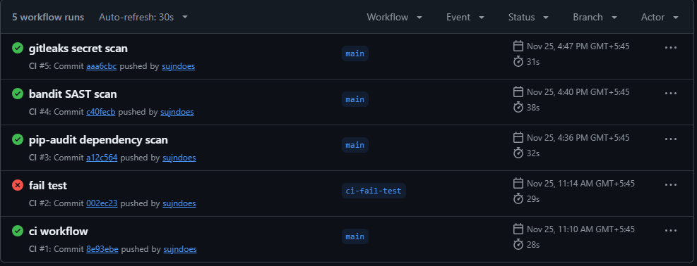
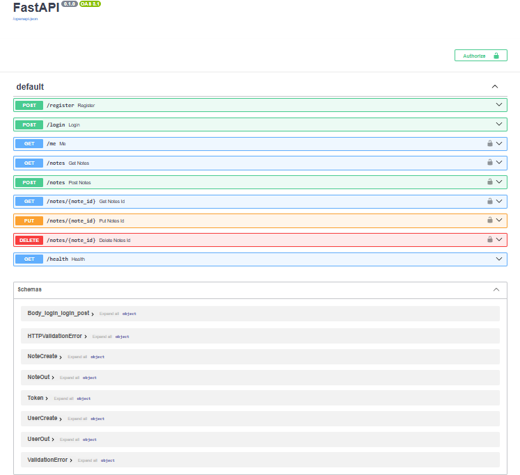

# SecureNotes API

A REST API for storing private notes, built to practice software, networking and security skills in one project. Users register and log in with Argon2-hashed passwords and 15-minute JWTs, and each user can only reach their own notes. The API validates input, rate limits logins and registrations, sets security headers, and runs behind a Caddy reverse proxy that terminates TLS.

The repository also has a STRIDE threat model and a GitHub Actions pipeline that runs the tests, a dependency scan, a code scan and a secret scan on every push. The test suite covers normal behavior and attack cases, such as one user trying to read, edit or delete another user's note.

Built with Python 3.11, FastAPI, SQLite through SQLAlchemy 2, argon2-cffi, PyJWT, slowapi, pytest and Caddy.

## Architecture



Clients talk to Caddy over HTTPS. Caddy forwards to uvicorn on the loopback address and sets the client IP in `X-Forwarded-For`. Requests to `/register` and `/login` pass through the rate limiter. Requests to `/me` and `/notes` need a valid token, and every notes query filters on the owner taken from that token.

## Endpoints

| Method | Path | Purpose | Token required |
|---|---|---|---|
| POST | `/register` | Create an account | No |
| POST | `/login` | Exchange email and password for a token | No |
| GET | `/me` | Return the logged-in user | Yes |
| GET | `/notes` | List your notes | Yes |
| POST | `/notes` | Create a note | Yes |
| GET | `/notes/{note_id}` | Read one note | Yes |
| PUT | `/notes/{note_id}` | Replace a note's title and body | Yes |
| DELETE | `/notes/{note_id}` | Delete a note | Yes |
| GET | `/health` | Liveness check | No |

Asking for a note that belongs to someone else returns 404, the same answer as for a note that does not exist.

## Screenshots

The padlock on `https://localhost/health`, served through Caddy with its local certificate:



GitHub Actions runs. The red run is on a throwaway branch where I broke a test on purpose to confirm that CI catches failures. The three green runs on `main` added the dependency, code and secret scans in turn:



The interactive docs, available when `ENVIRONMENT=development`. The lock icons mark the routes that need a token:



## Security summary

Passwords are hashed with Argon2id and must be 12 to 255 characters. Tokens are signed with HS256, expire after 15 minutes, and must carry `exp` and `sub` claims. The app refuses to start without a `SECRET_KEY` of at least 32 characters. Login gives the same error for an unknown email and a wrong password, and it spends the same time on both. Emails are lowercased before lookup.

Responses carry `X-Content-Type-Options`, `X-Frame-Options`, `Referrer-Policy` and `Cache-Control` headers. The API docs are off unless `ENVIRONMENT` is `development`. CORS is off because there is no browser frontend.

[SECURITY.md](SECURITY.md) explains the choices and the known limits. [docs/THREAT_MODEL.md](docs/THREAT_MODEL.md) maps each threat to a control, the evidence for it and the risk that remains.

## Run it locally

You need Python 3.11. On Windows, in Command Prompt:

```
git clone https://github.com/sujndoes/securenotes-api.git
cd securenotes-api
python -m venv .venv
.venv\Scripts\activate.bat
pip install -r requirements.txt
copy .env.example .env
```

On macOS or Linux, activate the environment with `source .venv/bin/activate` and copy the file with `cp .env.example .env`.

Open `.env`, set `ENVIRONMENT=development`, and replace the `SECRET_KEY` placeholder with a random key. This command prints one:

```
python -c "import secrets; print(secrets.token_urlsafe(48))"
```

Start the API:

```
uvicorn app.main:app --reload
```

The docs are at http://127.0.0.1:8000/docs. Port 8000 skips Caddy, so it has no TLS and no body size limit. Use it for development only.

### Settings

| Variable | Default | Notes |
|---|---|---|
| `SECRET_KEY` | none | Required, at least 32 characters |
| `DATABASE_URL` | `sqlite:///./securenotes.db` | |
| `ACCESS_TOKEN_EXPIRE_MINUTES` | `15` | |
| `ENVIRONMENT` | `production` | Set to `development` to enable `/docs` |

## Run it behind Caddy

Install Caddy from caddyserver.com, then start uvicorn so it listens on the loopback address only and trusts forwarded headers only from the proxy:

```
uvicorn app.main:app --host 127.0.0.1 --forwarded-allow-ips=127.0.0.1 --no-server-header
```

In a second window, from the project folder:

```
caddy run --config Caddyfile
```

On the first run Caddy creates a local certificate authority and asks Windows to trust it, so approve the prompt only on your own machine. `caddy untrust` removes it later. Then open https://localhost/health. The `Caddyfile` proxies `localhost` to `127.0.0.1:8000` and rejects request bodies over 1 MB.

If you test with curl on Windows, add `--ssl-no-revoke`, because Caddy's local certificates carry no revocation information.

## Tests and checks

```
python -m pytest
pip-audit -r requirements.txt
bandit -r app
```

CI runs all three on every push and pull request, and Gitleaks scans the full git history. The tests run against a separate SQLite file, `test.db`, which is rebuilt for each test, so they never touch your real data.

## Project layout

```
app/
  main.py           app setup, middleware, routers
  config.py         settings loaded from environment variables
  db.py             database engine and session
  models.py         User and Note tables
  schemas.py        request and response shapes
  security.py       password hashing and token functions
  dependencies.py   get_current_user
  limiter.py        rate limiter
  routes/
    auth.py         /register, /login, /me
    notes.py        notes endpoints
tests/              pytest suite and shared fixtures
docs/THREAT_MODEL.md
Caddyfile
SECURITY.md
.github/workflows/ci.yml
```

## Known limits

Tokens cannot be revoked before they expire, the rate limit is per IP address, notes are stored unencrypted in the SQLite file, and registering a taken email confirms that the address has an account. The full list is in [SECURITY.md](SECURITY.md).
