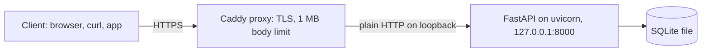

# Threat model

This covers the SecureNotes API, the Caddy proxy configuration and the CI pipeline in this repository. I used STRIDE. For each category I list what an attacker could try, the control I built, the evidence that it works, and the risk that remains. Evidence is either a test name from `tests/` or a manual check I ran by hand through Caddy or in the browser. No automated test covers the manual checks.

## What is being protected

The notes, which are private text. The password hashes. The `SECRET_KEY` that signs tokens, since anyone who holds it can act as any user. And the service staying usable for the people who registered.

## System and trust boundaries



Traffic from clients to Caddy is encrypted. Caddy forwards to uvicorn over plain HTTP on the loopback interface, so that hop never leaves the machine. The app reads and writes a local SQLite file. The CI pipeline runs separately on GitHub's runners and holds no real secrets.

The attackers I considered are an anonymous client on the internet, a registered user who wants another user's notes, and anything on the same machine that can reach port 8000 directly. Out of scope: anyone who controls the host or its operating system account (they can read the database and the key), physical access, network-level denial of service, and a compromised dependency that no scanner has flagged yet.

## Spoofing

| Threat | Control | Evidence | Residual risk |
|---|---|---|---|
| An attacker guesses passwords to log in as someone else | Argon2id hashing, 12 character minimum, 5 login attempts per minute per client IP | `test_login_wrong_password`, `test_login_is_rate_limited` | An attacker with many IP addresses never trips the limit. There is no per-account lockout and no multi-factor login. |
| An attacker forges or alters a token | HS256 signature, the algorithm fixed in the decode call, `exp` and `sub` required, a `SECRET_KEY` of at least 32 characters with no default | `test_token_without_expiry_is_rejected`, `test_short_secret_key_is_rejected`, `test_me_without_token`, `test_me_with_token` | One shared secret signs every token, so a leaked key lets anyone mint tokens for any user. |
| An attacker forges the client IP to dodge the rate limit or plant false log entries | Caddy overwrites `X-Forwarded-For`, and uvicorn trusts forwarded headers only from `127.0.0.1` | Manual: a forged header sent through Caddy logged the real address (`::1`), and the same header sent straight to port 8000 logged `1.2.3.4` | Anything that reaches port 8000 directly can forge its address. The firewall rule that blocks 8000 is deployment configuration, and the code does not enforce it. |

## Tampering

| Threat | Control | Evidence | Residual risk |
|---|---|---|---|
| A user edits or deletes another user's note by guessing its id | Every notes query filters on the owner taken from the token. A foreign note returns 404. Pydantic ignores undeclared fields, so a request body cannot set `owner_id`. | `test_cannot_edit_other_users_note`, `test_cannot_delete_other_users_note` | The filter lives in each query. A new route that forgets it reopens the hole, so each route needs its own cross-user test. No test sends an extra `owner_id` field. |
| Malformed input or injection | Pydantic checks the email format and every length. SQLAlchemy sends parameterized queries. | Bandit runs in CI and reports no issues. `test_register_success` covers the happy path. | Bandit and the schemas catch known patterns only. |
| Oversized request bodies | Caddy rejects bodies over 1 MB. Password length is capped at 255 characters. | Manual: a 2 MB request returned 413 from Caddy and never reached the app | A client that connects to port 8000 directly skips the Caddy limit. |
| Traffic read or altered in transit | TLS between the client and Caddy | Manual: padlock in the browser, and `curl --ssl-no-revoke -i https://localhost/health` returned 200 | The loopback hop between Caddy and uvicorn is plain HTTP. Local TLS uses Caddy's own certificate authority, which is only suitable for development. |
| A tampered dependency or pipeline | Pinned versions, `pip-audit` on every push, and the workflow token limited to `contents: read` | CI is green with the dependency scan, Bandit and Gitleaks | Dependabot is off. GitHub Actions are pinned to major version tags, not commit hashes. |

## Repudiation

| Threat | Control | Evidence | Residual risk |
|---|---|---|---|
| An attack happens and nothing records it | Failed logins are logged with the reason, the email and the client IP | The logging tests in `tests/` use pytest's `caplog` | Log lines go to the console. Nothing stores them, protects them from editing or applies a retention rule. The IP is only as reliable as the proxy path. |

## Information disclosure

| Threat | Control | Evidence | Residual risk |
|---|---|---|---|
| A user reads another user's notes | Owner filter on every query. Other users' notes return 404, not 403, so the response does not confirm the note exists. | `test_cannot_read_other_users_note`, `test_list_only_own_notes` | Same as the tampering row: the filter has to be repeated in every new query. |
| Someone learns which emails have accounts through login | The same 401 message for an unknown email and a wrong password, and a dummy hash check so the timing matches | `test_login_unregistered_email`, `test_login_wrong_password`. Manual timing check: 200.5 ms against 7.9 ms before the fix, 152.5 ms against 161.2 ms after. | I measured on one laptop, 10 requests per case. The timing script is not in the repository. |
| Someone learns which emails have accounts through registration | The rate limit slows probing | `test_register_duplicate_email` confirms the 409 | Accepted. A taken email must produce a different answer, so `/register` always confirms an account exists. |
| The password hash or another internal field appears in a response | `response_model` stencils (`UserOut`, `NoteOut`) list the fields that may leave the server | `test_register_success` checks there is no `password` or `password_hash`. `test_create_note` checks there is no `owner_id`. | A new schema has to be checked the same way. |
| Notes read straight from the database file | None. The notes are plain text in an unencrypted SQLite file. | None | Accepted. Whoever can read the file can read every note. Passwords are hashed. |
| The API map or the server software is exposed | `/docs`, `/redoc` and `/openapi.json` are off unless `ENVIRONMENT` is `development`, and the default is `production`. Uvicorn can hide its `Server` header with `--no-server-header`. | Manual: those three paths returned 404 in production mode | The docs stay closed only if `ENVIRONMENT` is set correctly. The header is visible unless the flag is used. |
| A secret is committed to git | `.env` is ignored, `.env.example` holds placeholders, and Gitleaks scans the full history on every push | The `gitleaks` job in CI is green | Gitleaks matches patterns and will miss a secret that looks like ordinary text. The key in `ci.yml` is a deliberate throwaway. |
| Private responses are cached | `Cache-Control: no-store` on every response the app produces | `test_security_headers` | Responses that Caddy produces itself, such as the 413, carry no such header. They hold no private data. |

## Denial of service

| Threat | Control | Evidence | Residual risk |
|---|---|---|---|
| A flood of logins or registrations | 5 requests per minute per client IP, counted separately for `/login` and `/register` | `test_login_is_rate_limited`, `test_register_is_rate_limited` | The counters sit in memory, so a restart resets them. Many IP addresses get around them. Each login costs about 150 ms of CPU on my laptop, so even a limited attacker uses real resources. |
| A legitimate user gets locked out by the limit | None | None | Accepted. Someone who mistypes the password five times waits a minute, and people behind a shared address share one counter. |
| Huge request bodies | The 1 MB Caddy limit and the schema length caps | Manual 413 check. The schemas cap the password at 255 characters, titles at 255 and note bodies at 10,000. | Port 8000 skips the Caddy limit. |
| A corrupted stored hash crashes login | `verify_password` returns False for an invalid hash, so login is denied | `test_verify_password_handles_garbage_hash` | The failure is silent. Nothing alerts me that a stored hash is broken. |

## Elevation of privilege

| Threat | Control | Evidence | Residual risk |
|---|---|---|---|
| A user acts with another user's rights | The owner comes from the token and is never read from the request | The cross-user tests under tampering and information disclosure | A stolen token works for its remaining 15 minutes. There is no logout or revocation. |
| A client skips the proxy and its controls | Uvicorn listens on `127.0.0.1` only, trusts forwarded headers from `127.0.0.1` only, and a firewall blocks port 8000 | Manual: the forged-IP experiment above | The firewall and the bind address are deployment settings. Nothing in the code checks them. |
| A user gains admin rights | There are no roles. Every account has the same rights over its own notes only. | None | If roles are added later, authorization has to be modeled again from the start. |

## Not built

No email verification, password reset, multi-factor login, account lockout, refresh tokens, token revocation, encryption of notes at rest, audit trail for note changes or per-account rate limit. Dependabot and branch protection are also off. Each is a reasonable next step, and none is needed for what this project sets out to show.

## Re-running the checks

The automated ones run in CI on every push. Locally:

```
python -m pytest
pip-audit -r requirements.txt
bandit -r app
```

The manual ones, with Caddy and uvicorn both running:

```
curl --ssl-no-revoke -i https://localhost/health
curl --ssl-no-revoke -i -X POST https://localhost/register -H "Content-Type: application/json" --data-binary @big.json
curl --ssl-no-revoke -X POST https://localhost/login -H "X-Forwarded-For: 1.2.3.4" -d "username=nobody@example.com&password=wrongpassword123"
curl -X POST http://127.0.0.1:8000/login -H "X-Forwarded-For: 1.2.3.4" -d "username=nobody@example.com&password=wrongpassword123"
```

The second command needs a `big.json` file of about 2 MB. The last two commands show the forged address ignored through Caddy and accepted when sent straight to uvicorn.
